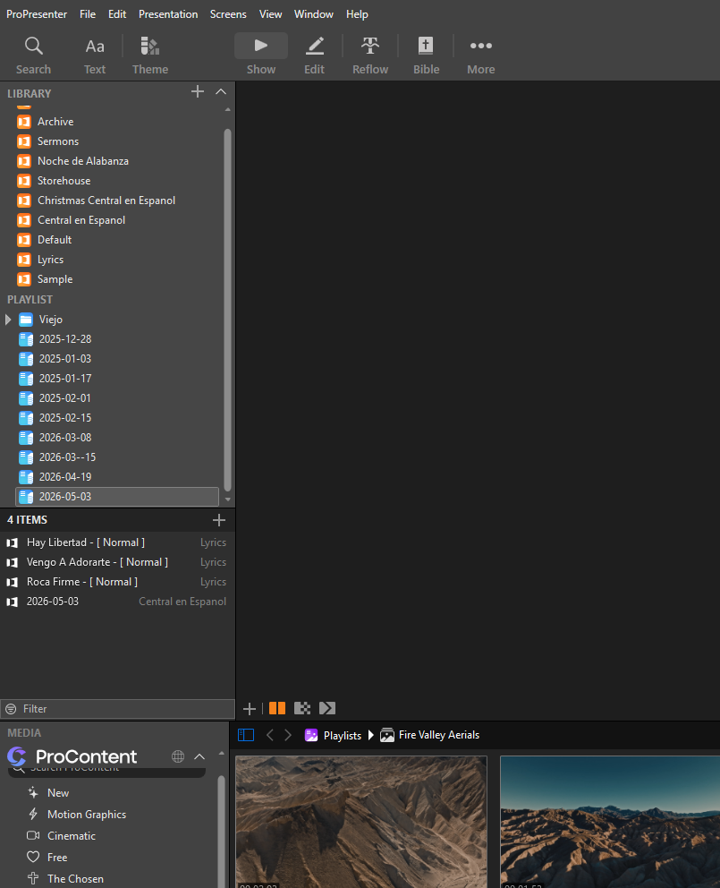

# Preparar un servicio en ProPresenter

**[Read this guide in English →](README.md)**

Convierte los archivos que ya recibes para el domingo en una lista de reproducción de ProPresenter. Dale a Codex las presentaciones de las canciones, el orden de alabanza y, si los tienes, los apuntes del sermón. Puede preparar letras editables, poner las canciones en orden y crear diapositivas sencillas para la predicación. Tú revisas el resultado en ProPresenter antes del servicio.



## Pruébalo en unos minutos

Abre ProPresenter y activa **Settings → Network → Enable Network** antes de
preparar el servicio. Ejecuta primero `python check_setup.py`. El programa lee
el puerto configurado en Windows y comprueba la API local. Se detiene de
inmediato si Network está desactivado, o después de un máximo de ocho segundos
si la API no responde. No reintenta ni sustituye la API por control de pantalla.
En otro sistema o para indicar otro puerto, usa
`--api-url http://127.0.0.1:PUERTO` o la variable `PROPRESENTER_API_URL`.

La preparación con `service_builder.py` hace la misma comprobación antes de
leer los archivos. El paso posterior `--apply` la omite porque ProPresenter
debe estar cerrado. `AGENTS.md` autoriza cerrar y reabrir la aplicación con su
confirmación habitual, y pide maximizar la ventana para revisar. No autoriza
descartar cambios sin guardar.

Los archivos de práctica incluyen una canción original de cuatro diapositivas. No necesitas una licencia bíblica para esta prueba.

1. Descarga este repositorio y abre su carpeta en Codex. Abre ProPresenter una vez en esta computadora para que cree su carpeta de datos.
2. Copia este mensaje en Codex:

   > Usa la habilidad `propresenter-service-builder` de este repositorio. Prueba `examples/practice-song.pptx` con `examples/practice-service.json`. Encuentra la carpeta de datos de ProPresenter. Revisa la instalación, prepara la lista de práctica, instálala cuando ProPresenter esté cerrado, vuelve a abrir ProPresenter y muéstrame qué debo revisar. No agregues sermón ni video en esta prueba.

3. Busca la lista **2099-01-01**. Abre **Luz en el camino (Practice)**. Debe empezar con una diapositiva vacía llamada **Background** y seguir con Verse 1, Chorus, Verse 2 y Chorus otra vez. Los grupos **Master** tienen un solo coro; el arreglo **Normal** lo repite en el orden de presentación. Al terminar, puedes borrar la lista de práctica desde ProPresenter.

También puedes abrir [los apuntes de sermón de práctica](examples/practice-sermon-notes.pdf). Muestran cómo puede verse un bosquejo corto. La diapositiva bíblica requiere acceso al texto de la Biblia solicitada; la práctica de letras funciona sin ella.

## Cómo preparar un domingo normal

**Lo que le das a Codex:** la fecha y el orden de las canciones, un PPTX por cada canción nueva, y cualquier nota de tono o capo. Si quieres, adjunta un PDF o DOCX del sermón y pide un fondo en video. Una captura del estilo que ya usan en ProPresenter también ayuda.

**Lo que prepara Codex:**

- Una lista con la fecha y las canciones en el orden indicado.
- Letras editables en la biblioteca **Lyrics**. Si la canción ya existe y coincide, la reutiliza. Codex compara el PPTX con la biblioteca, avisa si faltan frases y puede hacer correcciones de texto revisadas. Para una canción nueva crea grupos como estrofa, coro y puente, los grupos **Master**, un arreglo **Normal** para el orden de la canción y una primera diapositiva vacía llamada **Background**.
- Si lo pides, un video Full HD (1920 × 1080) en la diapositiva Background. Codex comprueba la resolución real y anota de dónde lo obtuvo. Los videos son opcionales y no vienen en este repositorio.
- Si lo pides, una presentación del sermón en **Central en Espanol**. Incluye una portada, una diapositiva por cada frase principal en **negrita y MAYÚSCULAS**, y diapositivas para los pasajes bíblicos citados. Las demás notas del bosquejo no aparecen en pantalla.

Puedes adaptar este mensaje cada semana y adjuntar los archivos:

> Prepara el servicio de ProPresenter para el 2026-10-04. Canciones en este orden: [títulos]. Adjunto un PPTX por canción y los apuntes del pastor. Reutiliza las canciones que ya estén bien en Lyrics. Usa el tema de letras incluido para las nuevas. Crea la lista con la fecha y un sermón sencillo en Central en Espanol. Usa Reina-Valera 1960 para los versículos si está disponible. Dime qué debo revisar antes del domingo. Si esa Biblia no está disponible, termina las canciones y explícame qué necesito pedirle al administrador de ProPresenter.

Codex revisa primero los archivos y la biblioteca, y prepara un borrador que se puede revisar. La instalación se hace con ProPresenter cerrado para que la aplicación no sobrescriba los archivos nuevos. Después abre la lista y revisa las diapositivas en la salida que verá la congregación.

### Así se ve el resultado

La imagen de arriba muestra dónde ProPresenter guarda las **bibliotecas** y las **listas con fecha**. Una canción empieza con **Background** y sigue con los grupos de letras. Un sermón comienza con su portada; después muestra pasajes con **Central Bible Format** y puntos principales grandes sobre fondo negro. Las letras usan **Lyrics Centered → Top Third - White**. Los paneles de vista previa y medios pueden verse distintos en tu computadora.

## Bibliotecas, temas y computadoras nuevas

| Nombre en ProPresenter | Para qué sirve |
| --- | --- |
| Biblioteca **Lyrics** | Presentaciones de canciones. Se reutilizan las que ya existen cuando corresponden. |
| Biblioteca **Central en Espanol** | Presentaciones de sermones. |
| Lista con nombre de fecha | Orden del servicio. |

Este repositorio trae tres temas portátiles en [`themes/`](themes/README.md):

| Tema | Uso |
| --- | --- |
| **Lyrics Centered → Top Third - White** | Letras nuevas. |
| **Black** | Portada y puntos principales del sermón. |
| **Plain Text → Central Bible Format** | Texto y referencia bíblica. Es el diseño bíblico al que cambiamos el nombre. |

En una instalación nueva, abre ProPresenter una vez. Al instalar el primer servicio, la herramienta crea las carpetas **Lyrics** y **Central en Espanol**, el archivo de listas y los temas incluidos que falten. No reemplaza los temas existentes. Si no ves los temas en el navegador de ProPresenter, cierra la aplicación y pídele a Codex que ejecute `install_themes.py`. Algunas fuentes pueden verse un poco distintas entre computadoras; revisa la salida del proyector. [Renewed Vision explica los temas aquí](https://support.renewedvision.com/hc/en-us/articles/11910559859603-Themes-in-ProPresenter).

El repositorio **no** incluye una licencia de ProPresenter, una traducción bíblica, canciones comerciales ni videos de bancos de medios. Guarda los archivos de la iglesia y las descargas donde la congregación acostumbra guardarlos.

## Acceso a la Biblia y preparación del sermón

Las letras funcionan sin comprar una Biblia. Para los versículos del sermón, Codex debe comprobar el texto exacto y la traducción. Si **Reina-Valera 1960 (RV1960)** no está disponible en ProPresenter, debe terminar la lista de canciones, dejar pendientes los versículos del sermón y decirte qué falta. También puedes proporcionar un texto que tu iglesia tenga permiso de usar. No cambiará de traducción sin avisarte.

Para comprobarlo en ProPresenter, abre **Bible → Options → Bibles**. Si hace falta, pide al administrador la licencia registrada de la iglesia y la Biblia RV1960. Renewed Vision indica que las traducciones con licencia requieren ProPresenter registrado y la compra de un código de desbloqueo; su [guía de instalación de Biblias](https://support.renewedvision.com/hc/en-us/articles/360041814913-Installing-Bibles-in-ProPresenter) explica el proceso. RV1960 aparece en su [lista de traducciones disponibles](https://support.renewedvision.com/hc/en-us/articles/33122394289043-Bible-Translations-Available-for-ProPresenter).

De un PDF o DOCX, el asistente toma el título, las referencias bíblicas y las frases que estén **en negrita Y EN MAYÚSCULAS**. Si el PDF es una imagen escaneada o el formato no es claro, comprueba la extracción contigo. Cada frase principal va en su propia diapositiva. El texto bíblico se agrega solo después de verificar la traducción. El programa que genera los archivos necesita una lista revisada con el texto exacto; no busca la Biblia por sí mismo.

## Revisión breve antes del domingo

Comprueba el orden de la lista, tonos y secciones, repeticiones del coro, ortografía y acentos, reproducción de videos, texto y referencia bíblica, y puntos principales del sermón. Revisa la **salida de audiencia** en la pantalla de 1920 × 1080. La primera diapositiva Background puede estar vacía o tener un video en bucle; las letras siguen siendo editables. Si encuentras un error, pídele a Codex que lo corrija.

## Para quien instala la herramienta

La habilidad de Codex está en [`skill/propresenter-service-builder/SKILL.md`](skill/propresenter-service-builder/SKILL.md). Abre esta carpeta en Codex y pídele que la use. Si quieres tenerla disponible desde otras carpetas, puedes copiar la carpeta de la habilidad a tu directorio de habilidades de Codex. La habilidad sigue todo el proceso: lee PPTX/PDF/DOCX, revisa bibliotecas y Biblia, prepara la lista de instrucciones para el generador, ejecuta los programas y comprueba la aplicación. El programa de Python solo genera archivos a partir de esa lista revisada.

Para usarlo manualmente en Windows, instala las dependencias de Python y cambia la ruta a la carpeta de datos que use tu ProPresenter:

```powershell
py -m venv .venv
.venv\Scripts\python.exe -m pip install -r requirements.txt
.venv\Scripts\python.exe check_setup.py --show-root 'C:\Users\TU_USUARIO\Documents\ProPresenter'
.venv\Scripts\python.exe service_builder.py examples\practice-service.json `
  --show-root 'C:\Users\TU_USUARIO\Documents\ProPresenter' `
  --stage '.\stage\practice'
```

Ejecuta los comandos desde la carpeta del repositorio para que encuentre el PPTX de práctica. La primera ejecución solo **prepara** archivos. Con ProPresenter cerrado, repite el último comando con `--apply` para hacer una copia de seguridad e instalarlos. El programa no instala archivos mientras ProPresenter esté abierto. Quien quiera preparar las instrucciones manualmente puede consultar [los campos y ejemplos del manifiesto](skill/propresenter-service-builder/references/manifest.md).

El proceso se probó con ProPresenter 18.4.1 en Windows. Los archivos generados usan [definiciones Protocol Buffer de la comunidad](https://github.com/greyshirtguy/ProPresenter7-Proto), con su licencia MIT incluida. ProPresenter no publica este formato como interfaz estable; después de actualizar la aplicación, comprueba los archivos preparados y el resultado instalado. La presentación y lista iniciales en [`templates/`](templates/) no contienen letras. Las canciones existentes se copian y solo reciben correcciones de texto explícitas; agregar secciones que falten a una canción existente requiere una edición revisada en ProPresenter o reconstruirla deliberadamente.
